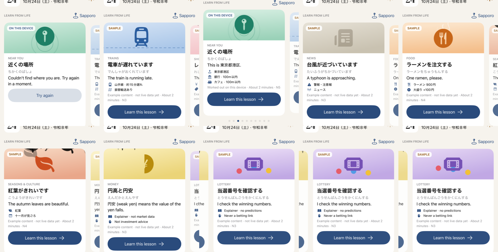

# Today · Life hub — màn Today sống động, mọi khía cạnh đời sống thành bài học

**Ngày:** 2026-10-24 · **Trạng thái:** client `IMPLEMENTED_LOCAL`; backend `IMPLEMENTED_LOCAL` ở `7c039cbc`, còn production gates: xem [today-life-hub-server-needs.md](today-life-hub-server-needs.md)
**Tiếp nối:** [today-life-learning-weather-slice.md](today-life-learning-weather-slice.md) (lát cắt thời tiết). Ảnh thật từ Simulator: [assets/life-hub/](assets/life-hub/) (bảng tổng hợp: `contact-sheet.png`).

## 1. Điều đã đổi trên Today

- **Thứ tự:** hero ôn tập (không đổi) → **life hub** → hàng bộ thẻ/thời lượng → tiến độ → “Học theo cấp độ”. Hero vẫn là hành động chính; mọi chức năng L05 (chọn bộ thẻ, thời lượng, tiến độ, điều hướng) còn nguyên và được kiểm lại.
- **Tiêu đề ngày** (tính tại máy, chính xác): ô lịch lật vào + số đếm lên, lời chào theo giờ (おはようございます / こんにちは / こんばんは) kèm cách đọc, `10月24日（土）· 令和8年`, biểu tượng buổi trong ngày nhấp nháy nhẹ.
- **Dải thẻ cuộc sống** (người dùng tự vuốt, không tự chạy; snap theo thẻ, chấm trang, haptic nhẹ, thẻ xa tâm nhỏ và mờ dần): ngày hôm nay, thời tiết (thật), quanh bạn (thật, opt-in), tàu điện, mua sắm, tin tức, ẩm thực, mùa & văn hóa, tiền bạc, xổ số.
- Mỗi thẻ có **cảnh động** riêng: ngày (lịch lật, số đếm lên), thời tiết theo mã WMO (nắng xoay + lấp lánh, mây trôi, sương mù, mưa/mưa rào/mưa to rơi, tuyết rơi, giông có chớp), quanh bạn (ghim nảy + sóng lan), tàu điện (đoàn tàu chạy trên đường ray chạy), mua sắm (xe đẩy + nhãn nảy, lấp lánh), tin tức (báo nhấp nháy), ẩm thực (hơi nước bốc lên), mùa & văn hóa (lá rơi), tiền (đồng yên xoay 3D), xổ số (bóng nảy). Nền gradient trôi chậm; sáng/tối đều có màu riêng.
- **Mọi thẻ mở cùng một hành trình** (câu chuyện → nhớ lại → nhận biết → lưu từ → hoàn tất → học lại các thẻ vừa lưu). Màn bài học có cùng cảnh động ở đầu, chip dữ kiện có biểu tượng, nhãn nguồn.
- **Accessibility và chuyển động:** Reduce Motion tắt toàn bộ hạt, xoay, trôi, parallax, đếm số, lật; cảnh dừng khi rời màn hình; mỗi thẻ là một phần tử VoiceOver (tên chủ đề, tiêu đề, tóm tắt, dữ kiện, nguồn) + nút riêng; cảnh là trang trí (ẩn khỏi VoiceOver).

## 2. Mỗi thẻ lấy dữ liệu từ đâu — và nhãn nói thật

| Nhãn trên thẻ | Nghĩa | Chủ đề hiện tại |
| --- | --- | --- |
| `LIVE` | Dữ liệu thật từ nguồn qua server | Ngày/ngày lễ Cabinet Office; thời tiết MET Norway (CC BY 4.0); bài biên tập đã được publish + xác nhận quyền |
| `ON THIS DEVICE` | Tính ngay trên máy, đúng sự thật | Ngày hôm nay (lịch của máy); **Quanh bạn** (vị trí + Apple Maps) |
| `SAMPLE` | Bài **mẫu viết tay**, chưa phải dữ liệu thật, ghi rõ “Example content · not live data yet” | Fallback khi feed chưa được bật/không có bài đã xuất bản |

`GET /api/life/feed` đã được triển khai. Khi trả 200 với feed hợp lệ, các thẻ server thay nội dung mẫu; thẻ ngày server có thể thay thẻ tính tại máy; “Quanh bạn” luôn ở trên máy. Trong giai đoạn chưa hoàn tất production gates, server chủ động trả 404 và hub giữ fallback hiện tại. Bài mẫu có thể tắt bằng `-com.flashcardapp.life.samples NO`.

**Mock không giả làm thật:** nhãn SAMPLE + dòng meta, cùng với lời giải thích “Tip/advice” cho điều không phải dữ kiện. Tiền bạc và xổ số chỉ là giải thích: không tỷ giá, không dự đoán, không khuyến nghị, không liên kết cá cược (có test).

## 3. Hai nguồn **thật** không cần server

1. **Ngày** (`LifeDateStory`): ngày/tháng/thứ/năm Reiwa/mùa/lời chào đều chính xác. Cách đọc ngày đúng (ついたち, ふつか … じゅうしちにち, はつか, にじゅうよっか, にじゅうしちにち, にじゅうくにち), chọn cách đọc `24日` có phương án sai là lỗi người học hay mắc. Kiểm thử đã bắt được lỗi 17/19/27/29 (đọc ずっと “なな/きゅう”) trước khi ra màn hình.
2. **Quanh bạn** (`LifePlaceProvider` + `LifeNearbyStory`): chỉ khi người dùng bấm “Dùng vị trí của tôi” (hệ thống hỏi quyền When-In-Use; mô tả quyền đã bản địa hóa vi/en/ja). Một lần đọc vị trí (độ chính xác ~100 m), tên địa danh bằng tiếng Nhật (CLGeocoder, `ja_JP`), loại địa điểm trong 900 m (MapKit). **Không lưu và không gửi toạ độ**, không chạy nền; chỉ tên và loại địa điểm nằm trong bộ nhớ. Ngoài Nhật Bản → báo rõ, không dạy sai. Từ chối → thẻ “Mở Cài đặt”. Bài dạy *loại* địa điểm (駅, カフェ, 公園…) vì tên cụ thể của Apple Maps có thể là tiếng Anh; cách đọc tên địa danh không có sẵn nên không bịa. Đã kiểm thật trên Simulator (vị trí giả lập Tokyo): “ここは東京都港区です。”, “近くに銀行があります。”, “100m以内”.

## 4. Kiến trúc (giữ VIPER/UIKit/RxSwift/Realm, không thêm framework)

- Hợp đồng chung: `LifeTopic`, `LifeFeedCard` (+ `status`: ready/loading/failed/needsLocation/locating/locationDenied), `LifeScene`, `LifeProvenance`, `LifeLesson` mở rộng (topic, provenance, chips, scene; `facts` chỉ cho thời tiết). Bài của mọi nguồn đi qua **cùng** màn bài học, kiểm tra và đường lưu từ idempotent.
- `LifeLessonDraft` viết bài ngắn gọn; `LifeDateStory`, `LifeNearbyStory`, `SampleLifeContent` dùng nó.
- `TodayLifeHubLoader` ghép: feed server → ngày/nơi trên máy → bài thời tiết → bài mẫu; backoff (404: 1 giờ, lỗi khác: 60 giây, sau lỗi thời tiết: 60 giây), hủy request khi đổi thành phố; không đọc vị trí lần đầu nếu người dùng chưa bấm; nếu từng đồng ý và hệ thống vẫn cho phép thì đọc lại mà không hỏi, tự dừng nếu bị thu hồi quyền.
- Lưu ý kỹ thuật: `CLGeocoder` bị hệ thống giới hạn tần suất (mở lại app liên tục sẽ báo “Couldn't find where you are”); thử lại sau ít phút là được, `Try again` có sẵn. Từ iOS 26 `CLGeocoder` bị đánh dấu deprecated (thay bằng `MKReverseGeocodingRequest`); dùng tạm vì trả chuỗi hành chính tiếng Nhật đơn giản.

## 5. Kiểm chứng

- Toàn bộ `FlashcardAppTests`: **759/759** đạt, 0 bỏ qua (706 trước + 53 test mới: lịch/số tiếng Nhật, bài ngày, bài quanh bạn, nội dung mẫu, hợp đồng feed, hub loader, presenter).
- Coverage logic mới (đo bằng xcresult): `JapaneseCalendar` 100%, `LifeNearbyStory` 99,3%, `SampleLifeContent` 99%, `LifeFeedMapper` 97%, `LifeDateStory` 95,4%, `TodayLifeHub` 92,2%, `LifeLessonPresenter` 93,9%, `BJTLifeFeedAPI` 91,7%. `LifePlaceProvider` chỉ 37,8% bằng unit test (CoreLocation/MapKit không dựng được trong unit test): kiểm bằng chạy thật trên Simulator.
- UI test thật: hub (ngày, nút ôn còn nguyên, thẻ ngày), một bài **mẫu** chạy từ Today (gõ 遅れて, chọn cách đọc, lưu; làm lại → “Đã có trong …”, không trùng) và bài thời tiết với backend thật (dev API `localhost:4011`, build setting `PRODUCT_BASE_URL`). Kết quả: **3/3 đạt** (14 s, 78 s, 51 s).
- Thật trên Simulator: dải thẻ, vuốt snap, chấm trang, quyền vị trí (hộp thoại hệ thống với mô tả đã bản địa hóa) → “Allow While Using App” → bài quanh bạn từ vị trí giả lập → mở bài học có cảnh động.
- Layout Today/Life card đã được mở ở `UICTContentSizeCategoryAccessibilityXXXL` trên iPhone 17e Simulator sau fix accessibility; screenshot được kiểm bằng mắt, không thấy xung đột Auto Layout.
- Sau khi backend Life Hub hoàn thành, `LifeFeedMapperTests` chạy lại **6/6 đạt**; regression test khóa `cityID` theo thành phố được request và ngôn ngữ chip theo tham số mapper (`0e53e5a`).

## 6. Chưa kiểm / giới hạn

- Chuyển động chỉ xem được qua ảnh chụp tĩnh (đã thấy mưa, lá, sóng, tàu, lịch ở các khung); chưa có đo FPS/năng lượng. CAEmitterLayer chạy chỉ khi thẻ ở trong cửa sổ; chưa đo ở iPhone cũ.
- VoiceOver thật, chế độ tối, Reduce Motion bật, iPad, thiết bị thật, ja/vi bằng mắt (chỉ vi trong UI test): chưa kiểm.
- Cách đọc/nội dung của bài mẫu và bài do mẫu tạo **chưa có người biên tập Nhật ngữ xác nhận**.
- E2E đầy đủ iOS ↔ backend Life Hub mới và đăng nhập admin thật chưa chạy. Backend còn phải chạy migration, cấu hình `MET_NORWAY_USER_AGENT`, xuất bản ít nhất một bài đã kiểm duyệt/xác nhận quyền; dữ liệu ngày lễ hiện đến hết 2027.
